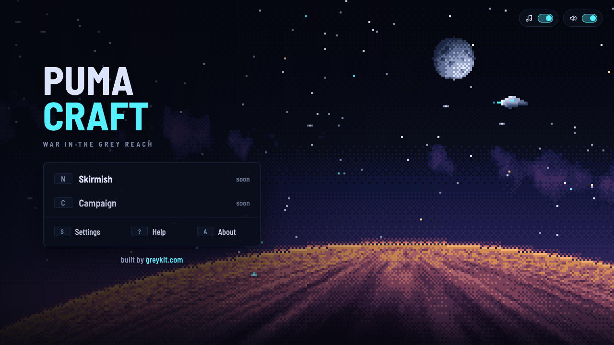

# PumaCraft

**War in the Grey Reach.** Real-time strategy in the manner of the late-1990s classics, *StarCraft* (Blizzard Entertainment, 1998) above all: three powers that play nothing alike, bases and economies, armies and their counters. Every world, name, picture and sound in it is its own.

**Play:** [greykit.com/games/pumacraft](https://greykit.com/games/pumacraft/)

## How it plays

PumaCraft is being built. Open now is **skirmish** against training targets (bases that mine but do not build or attack), on the drawn Proving Ground or a map made from any seed, as the Pumacity Defense Force: mining, building, training and fighting, with three save slots. The computer opponent and the campaign come next. When it is whole, it plays like this.

Mine ore and draw vapour, raise a base, train an army and break your enemy's. Three powers fight over the Reach: the Pumacity Defense Force, the Wolf Empire's Horde and an older power the war has woken, each with its own units, buildings, upgrades and way of growing. Skirmish against the computer on drawn or generated maps, or play a campaign of three acts, one for each power. The art is painted 16-bit pixel art, and the score follows the battle, rising as it does.

## Keys

A desktop game for mouse and keyboard. `?` on the title screen lists the keys; `M` is sound.

## Saves

Settings and saved games are kept in the browser's `localStorage` under keys starting `pumacraft_`; any game can also be saved to a file from the pause menu (F10) and loaded back from the title. **Settings → Forget everything** clears them.

## Credits

*StarCraft* was designed by Blizzard Entertainment, led by Chris Metzen and James Phinney. PumaCraft is not affiliated with Blizzard Entertainment and uses none of its code, art, sound or text.

Typefaces: [Barlow Semi Condensed](https://fonts.google.com/specimen/Barlow+Semi+Condensed) and [Pixelify Sans](https://fonts.google.com/specimen/Pixelify+Sans), under the SIL Open Font License.

Working on the game: [DEVELOPMENT.md](DEVELOPMENT.md).

By Matthew "Shan" Romanek, with Claude. Built by [greykit.com](https://greykit.com/).

Made for my own play. Nothing here is offered: no support, no updates, no licence.
